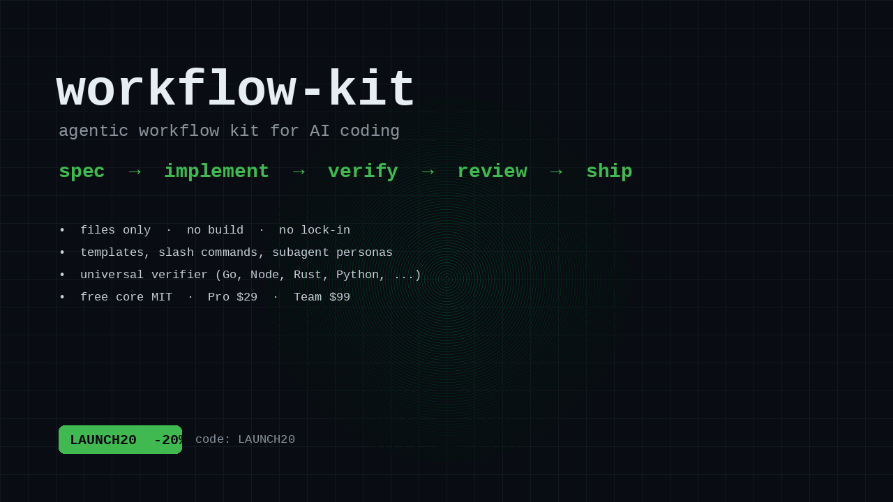

# workflow-kit

Personal agentic workflow improvement kit (Oscar). Non-destructive, local-first.

OpenCode-native dev toolkit: sweep, doctor, smartclean, monokit, and a universal
verifier (`wf-verify`) across Go/Bun/Rust/Python/Make/TS. Not another generic
spec kit — built for the OpenCode ecosystem.
## Product

**Stop vibe-coding. Ship agentic changes with a repeatable loop.**

workflow-kit is a files-only kit — spec templates, slash commands, subagent
personas, and a universal verifier (`wf-verify`) — for AI-assisted coding with
OpenCode/Claude Code/Cursor/Aider. No build, no service, no lock-in; works
offline once installed.

- **Tiers:** Free ($0, MIT), Pro ($29 one-time), Team ($99 one-time, up to 5
  seats). See [docs/PRICING.md](docs/PRICING.md).
- **Install one-liner:**
  `git clone git@github.com:farishan/workflow-kit.git ~/dev/workflow-kit && cd ~/dev/workflow-kit && ./install.sh`
  (details: [docs/INSTALL.md](docs/INSTALL.md)).
- **Landing page:** [site/index.html](site/index.html)
- **Docs:** [docs/](docs/) — ARCHITECTURE, COMPARISON, PLAYBOOK, INSTALL, FAQ, PRODUCT, PRICING, RELEASE, LAUNCH-CHECKLIST, GUMROAD-SETUP.- **Examples:** [docs/EXAMPLES.md](docs/EXAMPLES.md) — all example projects and `wf-verify` commands.

## Buy

- Free core: [github.com/farishan/workflow-kit](https://github.com/farishan/workflow-kit) (MIT)
- Pro ($29): https://farishan1.gumroad.com/l/sknrfm — codes: `WK20` (20% off), `FIRST10` (50% off first 10 orders), `VIP50` (50% off 5 orders)
- Team ($99, up to 5 seats): https://farishan1.gumroad.com/l/oxfqak
- Free starter (lead magnet): https://farishan1.gumroad.com/l/bqpoc

## Contents
- `templates/` — SPEC.md, PLAN.md, ACCEPTANCE.md
- `bin/wf-verify` — universal verifier (Go/Bun/Node/Rust/Deno/Ruby/TS/Make/Python)
- `commands/` — /spec /plan /verify /test /review /ship /flow /status /doctor
- `agents/` — implementer, tester, docs-writer, code-reviewer, go-programmer, software-architect, Oscar (primary)
- `selftest.sh`, `install.sh`, `.github/workflows/verify.yml`
- `docs/PLAYBOOK.md` — better flow + command reference

## Examples

See [docs/EXAMPLES.md](docs/EXAMPLES.md) for all example projects and their
`wf-verify` commands.

## Better flow (see flower viz)
1. Spec (`/spec`) → SPEC/PLAN/ACCEPTANCE
2. Spawn isolated workers (herdr + pi)
3. Implement
4. Verify (`wf-verify` / `/verify`)
5. Review (`/review`)
6. Fix → verify
7. Approve
8. Ship (`/ship`)
9. Log memory + status

## Verify runner behavior
- If `verify.sh` present and executable → run it
- else Go (`go.mod`) → gofmt check + vet + build + test
- else Bun/Node (`package.json`) → typecheck/check + test + build (if scripts exist)
- else Python → pytest (if tests present)
- else → no-op success

## Install / sync
Files live in config; no build needed. `wf-verify` must be on PATH (`~/.local/bin`).
